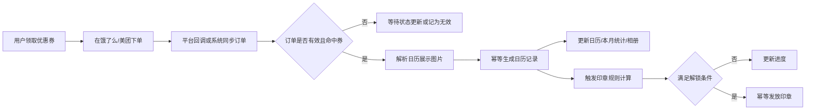

# 订单驱动的印章产品需求文档（复刻稿）

> 版本：v0.2 Draft  
> 更新日期：2026-11-16  
> 详细范围：全局“印章”Tab 及其订单记录、日历回顾、印章解锁能力  
> 参考来源：用户提供的 4 张截图与两轮业务说明

## 0. 阅读说明

全文使用以下标签区分信息来源：

- **[截图确认]**：可直接从截图观察到。
- **[用户确认]**：来自本次业务说明，优先级高于截图推断。
- **[方案建议]**：为形成可开发、可验收闭环而补充。
- **[待确认]**：会影响数据口径或交互，需要后续决策。

### 0.1 本版相对初稿的关键修正

1. **[用户确认]** App 全局底部 Tab 固定为：`印章 / 积分 / 积分商城 / 我的`。
2. **[用户确认]** 截图中的日历、印章墙、本月记录弹层和月度相册，全部属于“印章”Tab。
3. 截图中的“杯子 / 印章 / +”不能照搬为全局导航：杯子与印章改为模块内子导航，`+` 入口取消。
4. 用户不再手工创建记录。记录来源改为：用户领券下单后，系统根据平台订单自动生成。
5. 饿了么优先使用订单回传图片；美团因不回传图片，使用后台规则命中的配置图/默认图。

本文中的两个相近概念定义如下：

- **日历记录**：由一笔符合条件的优惠券订单自动生成，显示在月历、本月弹层和相册中。
- **印章成就**：系统根据日历记录与后台规则自动解锁的收藏对象，技术模型使用 `badge`。

## 1. 产品概述

### 1.1 产品定位

以优惠券订单为数据来源的消费记录与成就系统。用户领券并在饿了么或美团完成符合条件的订单后，无需手动上传或填写，系统自动把订单转成日历记录，并按后台配置条件解锁印章。

### 1.2 核心价值

- 自动记录：减少手工操作，订单完成后自动进入日历。
- 月度回顾：用日历、记录卡片与照片墙回看消费轨迹。
- 成就激励：用店铺、城市、次数、杯数等条件自动解锁印章。
- 运营可配：图片映射与印章规则均由后台配置并可审计。

### 1.3 核心业务闭环



### 1.4 MVP 目标

1. 跑通“领券—下单—订单同步—生成日历记录—自动解锁印章”的完整链路。
2. 复刻四张截图体现的印章模块信息结构，同时使用新的四项全局底部导航。
3. 保证饿了么和美团都能得到稳定、非空的日历展示图。
4. 保证订单重复回调、主动补拉和任务重跑不会生成重复记录或重复印章。
5. 后台能够解释：一条记录为何生成、用了哪张图、命中了哪条规则、某枚印章为何解锁或未解锁。

### 1.5 范围边界

本稿详细定义“印章”Tab。以下三个 Tab 仅确认全局入口，本期不展开业务：

- 积分：不定义余额的获取与扣减规则、过期和明细；页面版式、签到与金刚区见《交互稿实施规划》§17。
- 积分商城：不定义商品、库存、兑换、支付、物流和退款。
- 我的：不定义账户、权益、客服和设置详情。

印章模块可以发布 `badge.unlocked` 等标准事件，但**不默认假设解锁印章会发积分**；任何积分联动需另立 PRD。

## 2. 截图与最终产品的对应关系

| 参考图 | 最终页面定位 | 说明 |
|---|---|---|
| `assets/01-home-calendar.jpg` | 印章 Tab → 记录日历 | 印章模块默认子页面 |
| `assets/02-badge-wall.jpg` | 印章 Tab → 印章墙 | 印章模块内部子页面 |
| `assets/03-month-records-modal.jpg` | 记录日历 → 本月记录弹层 | 点击“本月”打开 |
| `assets/04-month-gallery.jpg` | 记录日历 → 月度相册 | 点击首页右侧相册入口打开 |

<table>
  <tr>
    <td></td>
    <td></td>
    <td></td>
    <td></td>
  </tr>
</table>

截图仅作为印章模块内部页面与视觉参考。截图原底栏不代表最终 App 全局导航。

## 3. 信息架构

```text
App
├─ 印章 Tab（本稿详细范围）
│  ├─ 记录日历（默认子页面）
│  │  ├─ 月历与订单记录
│  │  ├─ 本月统计
│  │  ├─ 本月记录弹层
│  │  └─ 月度相册
│  ├─ 印章墙
│  │  ├─ 印章汇总
│  │  ├─ 分类/状态筛选
│  │  └─ 印章详情
│  └─ 印章解锁反馈
├─ 积分 Tab（版式见交互稿 §17，积分规则不在本稿）
├─ 积分商城 Tab（本稿不展开）
└─ 我的 Tab（本稿不展开）
```

页面分层口径（与交互稿 §6.1 一致）：印章 Tab 的「记录日历 / 印章墙」、积分、积分商城、我的都是一级页面（Tab 入口）；**月度相册、订单记录详情是整页跳转的二级页面**；弹窗一律挂在宿主页下，不单列为页面。

### 3.1 全局底部导航

| 顺序 | Tab | 本稿要求 |
|---|---|---|
| 1 | 印章 | 默认进入记录日历；承载本稿全部功能 |
| 2 | 积分 | 仅还原版式与金刚区入口（见交互稿 §17），不定义积分规则 |
| 3 | 积分商城 | 仅保留导航入口，不展开页面逻辑 |
| 4 | 我的 | 仅保留导航入口，不展开页面逻辑 |

- 全局底栏始终固定在安全区上方。
- 当前 Tab 有图标、文字和颜色选中态，不只依靠颜色。
- 从其他 Tab 返回“印章”时，恢复上次停留的子页面、月份与滚动位置。

### 3.2 印章模块内部导航

**[方案建议]** 将截图中的杯子/印章胶囊切换改为顶部二级分段控件：

- 记录日历
- 印章墙

不建议在全局底栏上方再叠加第二层底部导航。若视觉必须贴近截图，也只能把胶囊作为内容内切换控件，并移除 `+`。

### 3.3 导航返回规则

- 本月记录弹层和月度相册关闭后，返回记录日历并保留月份与滚动位置。
- 印章详情关闭后，返回印章墙并保留筛选与滚动位置。
- 首次进入印章 Tab 时默认显示记录日历。

## 4. 订单自动生成日历记录

### 4.1 主流程

```text
用户领取活动优惠券
→ 在对应平台下单
→ 接收平台回调，或由定时任务主动同步订单
→ 关联 App 用户、券实例与平台订单
→ 校验订单状态和参与资格
→ 标准化商品、店铺、城市、数量与业务时间
→ 根据平台解析展示图片
→ 幂等创建/激活日历记录
→ 更新月历、本月统计与相册
→ 发布日历记录激活事件
→ 计算并解锁符合条件的印章
```

日历记录属于订单衍生数据。用户不能修改平台、订单号、券实例、订单业务时间和系统命中的图片；是否允许收藏或修改展示昵称，见页面规格。

### 4.2 用户与订单关联

系统必须通过以下至少一种稳定标识把平台订单归属到 App 用户：

- 用户领取的券实例 ID。
- 发券链接/活动参数携带的用户或活动追踪 ID。
- 已授权绑定的平台用户标识。

关联失败的订单进入异常队列，不得误归属给其他用户。后台需支持按平台订单号、券实例和用户查询处理链路。

### 4.3 统一订单状态

```text
RECEIVED（已接收）
→ WAITING_ELIGIBLE（等待有效状态）
→ ACTIVE（有效，已生成日历记录）
→ INVALID（取消、退款、未核销或判定无效）
```

| 状态 | 日历展示 | 参与统计/印章 | 说明 |
|---|---|---|---|
| RECEIVED | 否 | 否 | 原始回调已接收，尚未标准化完成 |
| WAITING_ELIGIBLE | 否 | 否 | 未达到配置的有效订单状态 |
| ACTIVE | 是 | 是 | 创建或激活日历记录 |
| INVALID | 否 | 否 | 记录保留审计，但从用户视图隐藏 |

**[待确认]** 什么状态算“下单成功”。建议默认使用“已完成/已核销”，避免取消单提前解锁；如果业务要求“已支付”立即展示，可先生成待确认记录，但在完成前不参与印章计算。

### 4.4 订单记录生成粒度

**[方案建议]** 一条日历记录对应一次有效优惠券核销，唯一键优先采用：

```text
(platform, platform_order_id, coupon_instance_id, qualifying_item_id)
```

若平台无法提供券实例或合格商品 ID，则按可用字段退化，但必须保留唯一约束。

- 同一订单只有一张合格券时，生成 1 条日历记录。
- 同一订单有多张合格券时，可按券实例生成多条记录。
- 同一券对应多件商品时，记录数与“杯数”口径需业务确认；MVP 建议一张券一条记录，`quantity` 保存合格商品数量。

### 4.5 业务时间与月份归属

- 日历日期使用平台订单的业务时间，不使用回调到达时间。
- **[待确认]** 业务时间选下单、支付、完成还是核销时间；建议使用券核销/订单完成时间，缺失时回退支付时间。
- 保存 `record_timezone` 与 `local_date`，避免以后切换账号时区导致历史归属漂移。
- 默认时区为 `Asia/Shanghai`。
- 延迟回调或历史补单仍按原业务时间进入正确日期与月份。

### 4.6 回调、主动同步与补偿

实时链路：

1. 验签并接收平台回调。
2. 脱敏保存原始事件与 `event_id`。
3. 转换为统一订单模型并幂等更新状态。
4. 创建、激活或失效日历记录。
5. 发布 `calendar_record.activated` / `calendar_record.invalidated`。

补偿链路：

- 定时拉取最近订单，与领券/核销记录对账。
- 查找“订单已有效但无日历记录”“记录有效但订单已失效”等异常。
- 超过重试次数进入异常任务列表，支持人工重放。
- 回调乱序时按平台状态版本或状态更新时间处理，旧事件不能把已退款订单重新激活。

### 4.7 幂等与一致性

- 重复回调、主动轮询、人工重放和任务重跑不得创建重复记录。
- 同一事件通过 `event_id` 去重；同一业务记录通过订单唯一键兜底。
- 订单写入、记录生成和待发布事件建议使用事务或 Outbox。
- 日历记录激活只发布一次有效事件；印章发放另有用户印章唯一键保证幂等。

## 5. 平台图片策略

### 5.1 通用要求

- 每条 ACTIVE 日历记录必须有可展示图片，日期格不得空白。
- 最终图片需生成稳定的自有媒体资源与缩略图，不长期依赖平台外链。
- 保存图片来源、命中规则、规则版本、解析时间和失败原因。
- 图片解析失败不能阻塞记录生成；先使用兜底图，后台继续重试。

### 5.2 饿了么

**[用户确认]** 饿了么会回传订单图片，系统自动获取并放入日历。

建议解析顺序：

1. 优惠券实际抵扣商品的图片。
2. 无法定位抵扣商品时，取订单主商品图片。
3. 平台图缺失、不可访问或下载失败时，匹配后台配置图。
4. 使用饿了么平台默认图。
5. 使用系统全局默认图。

平台图片需下载并转存至自有对象存储，校验格式、大小和可访问性。若当前使用回退图，后续成功取得饿了么原图时，**[方案建议]** 可自动升级为原图并保留图片更新日志。

### 5.3 美团

**[用户确认]** 美团不回传订单图片；订单需命中后台图片配置，使用对应的配置图/默认图进入日历。

建议匹配优先级：

1. 券实例、券模板或活动 ID。
2. 商品 SKU ID。
3. 商品 ID。
4. 店铺 ID。
5. 品牌 ID。
6. 商品类别。
7. 美团平台默认图。
8. 系统全局默认图。

每条图片规则至少配置：平台、匹配字段、匹配值、图片资源、优先级、生效/失效时间、启用状态和版本。

同一订单命中多条规则时：

1. 数字优先级高者优先。
2. 优先级相同时，更具体的规则优先。
3. 仍冲突时取最近发布版本，并产生后台告警。

### 5.4 图片快照与历史更新

创建记录时固化：

- `image_source`：`ELEME_ORDER`、`ADMIN_RULE`、`PLATFORM_DEFAULT` 或 `SYSTEM_DEFAULT`。
- `image_asset_id`。
- `image_rule_id` 与 `image_rule_version`（如适用）。

后台更换默认图只影响新记录，不静默改变历史记录。需要替换历史图片时，由管理员显式发起“重新取图/重新匹配”任务，并保留变更日志。

## 6. 印章 Tab 页面与交互规格

### 6.1 记录日历

#### 页面结构

1. 印章模块内部“记录日历 / 印章墙”切换。
2. 顶部辅助入口：左侧齿轮、右侧 `M` 按钮（语义待确认）。
3. 今日标题及完整日期、星期。
4. 七列自然月日历。
5. 本月杯数、去重店铺数、代表图与月度相册入口。
6. 全局四项底部 Tab。

| 编号 | 需求 | 说明 | 优先级 |
|---|---|---|---|
| CAL-01 | 当前日期 | 格式示例：`2026年11月16日，周一` | P0 |
| CAL-02 | 自然月日历 | 固定七列，正确处理首日偏移与月天数 | P0 |
| CAL-03 | 无记录日期态 | 浅灰底块 + 日期数字 | P0 |
| CAL-04 | 今日态 | 橙色底块，覆盖普通无记录态 | P0 |
| CAL-05 | 单条记录日期态 | 展示订单解析后的缩略图 | P0 |
| CAL-06 | 多条记录日期态 | 展示代表图并在右上显示数量；仅 `count > 1` 出现角标 | P0 |
| CAL-07 | 代表图 | 取当日业务时间最新的 ACTIVE 记录图 | P0 |
| CAL-08 | 本月杯数 | 本月 ACTIVE 记录的合格商品 `quantity` 之和 | P0 |
| CAL-09 | 本月店铺数 | 本月 ACTIVE 记录标准化 `shop_id` 去重数 | P0 |
| CAL-10 | 点击“本月” | 打开本月记录弹层 | P0 |
| CAL-11 | 点击相册入口 | 打开当前月份的月度相册 | P0 |
| CAL-12 | 点击有记录日期 | 打开当日记录列表；单条、多条行为保持一致 | P1 |
| CAL-13 | 自动刷新 | 新订单生效后刷新受影响日期和月份统计 | P0 |

日期格状态建议优先级：

`被选择 > 今天且有记录 > 有多条记录 > 有一条记录 > 今天无记录 > 普通日期`

截图数据可核对为 11 月共 5 条记录，其中 11 月 14 日 2 条。复刻测试数据应保证月历、本月弹层和相册三处数量一致。

### 6.2 本月记录弹层

- 顶部显示“本月”、杯数、店铺数和关闭按钮。
- 内容为双列订单记录卡，按业务时间倒序。
- 卡片包含展示图、展示名称、业务时间和收藏星标。
- 数据仅来自当前月 ACTIVE 日历记录。

| 编号 | 需求 | 说明 | 优先级 |
|---|---|---|---|
| MONTH-01 | 汇总口径 | 与日历首页杯数、店铺数完全一致 | P0 |
| MONTH-02 | 展示名称 | 优先订单商品名；后台可配置面向用户的展示名 | P0 |
| MONTH-03 | 图片 | 饿了么优先订单图；美团使用配置图/默认图 | P0 |
| MONTH-04 | 排序 | `business_at` 倒序，同时间按记录创建时间倒序 | P0 |
| MONTH-05 | 收藏 | 用户可收藏/取消收藏，失败时回滚 | P1 |
| MONTH-06 | 卡片点击 | 打开只读记录详情 | P0 |
| MONTH-07 | 空态 | 显示“本月暂无符合条件的订单记录” | P0 |
| MONTH-08 | 关闭 | 返回记录日历并保留状态 | P0 |

### 6.3 月度相册

- 顶部为年月选择、左侧待确认图标与关闭按钮。
- 内容为双列拍立得式照片卡片。
- 卡片显示订单图或后台配置图、名称及业务时间。

| 编号 | 需求 | 说明 | 优先级 |
|---|---|---|---|
| GALLERY-01 | 默认月份 | 从记录日历进入时沿用当前月份 | P0 |
| GALLERY-02 | 月份切换 | 点击月份选择历史年月；未来月份不可选 | P0 |
| GALLERY-03 | 数据范围 | 只展示目标月 ACTIVE 记录 | P0 |
| GALLERY-04 | 图片一致性 | 使用与月历/本月卡相同的已解析媒体资源 | P0 |
| GALLERY-05 | 卡片信息 | 业务时间必显，展示名称有值时显示 | P0 |
| GALLERY-06 | 卡片点击 | 打开只读记录详情或大图预览；MVP 建议详情 | P0 |
| GALLERY-07 | 左上图标 | [待确认] 可能是多选或布局切换，确认前不绑定业务 | P1 |
| GALLERY-08 | 关闭 | 返回记录日历并保留月份与滚动位置 | P0 |

饿了么与美团使用统一卡片尺寸和裁切规则，避免用户感知平台数据能力差异。

### 6.4 订单记录详情

**[方案建议]** 详情页为只读业务详情，展示：

- 图片、展示名称、平台标识。
- 店铺、城市、数量与业务时间。
- 收藏状态。
- 可选的订单状态说明。

用户不可修改订单来源、订单号、优惠券、商品数量、图片和业务时间。订单号应脱敏显示，完整信息仅后台可查。

### 6.5 印章墙

#### 页面结构

1. 印章模块内部子导航。
2. “所有印章”下拉筛选。
3. `印章数 * 店铺数 * 城市数` 汇总。
4. 双列印章陈列。
5. 全局四项底部 Tab。

| 编号 | 需求 | 说明 | 优先级 |
|---|---|---|---|
| BADGE-01 | 印章列表 | 展示后台配置为可见的印章 | P0 |
| BADGE-02 | 状态 | 未解锁、已解锁、隐藏、已撤销 | P0 |
| BADGE-03 | 已解锁样式 | 彩色素材与 `earned_at` 日期 | P0 |
| BADGE-04 | 未解锁样式 | 灰态/遮罩，不显示虚假日期 | P0 |
| BADGE-05 | 汇总数字 | 默认统计已解锁印章、ACTIVE 记录去重店铺与城市 | P0 |
| BADGE-06 | 筛选 | 全部、已解锁、未解锁、店铺、城市等 | P1 |
| BADGE-07 | 点击印章 | 打开印章详情 | P0 |
| BADGE-08 | 顶部两侧图标 | 语义待确认，不凭截图擅自绑定 | P1 |
| BADGE-09 | 分页/分组 | 截图底部 `－ 1 －` 语义待确认，MVP 可连续滚动 | P1 |

截图无法证明无圆框或无日期的图案就是未解锁状态，状态应由接口字段决定，而不是客户端根据素材外观猜测。

### 6.6 印章详情与解锁反馈

印章详情建议展示：图片、名称、说明、已解锁/未解锁状态、解锁条件、当前进度、解锁日期以及触发记录。隐藏印章在解锁前不透露名称和条件。

解锁反馈规则：

- 同一时刻解锁多枚时合并展示。
- 在线时显示一次性弹层/动效；异步解锁则在下次进入印章 Tab 时提示。
- 通知失败不回滚已写入的印章。
- 本稿不定义解锁后增加积分。

### 6.7 页面状态

| 场景 | 处理 |
|---|---|
| 本月无记录 | 保留完整月历，本月统计为 0，说明需完成符合条件的领券订单 |
| 订单同步中 | 不展示不确定记录；后台继续同步，成功后刷新 |
| 图片解析中/失败 | 先用平台或系统默认图，页面不留空白 |
| 月份请求失败 | 保留月份标题，局部错误态与重试按钮 |
| 无印章 | 空态说明获取方式，不生成伪造印章 |
| 规则计算延迟 | 不阻塞订单记录展示，稍后补充解锁提示 |

## 7. 印章规则系统

### 7.1 规则原则

- 只使用 ACTIVE 日历记录作为有效事实数据。
- 规则由后台白名单字段配置，不允许运营填写任意 SQL 或脚本。
- 日历记录激活、失效或规则发布时触发计算。
- 发放过程幂等、可解释、可补算、可审计。
- 已发布规则不可原地覆盖，修改时生成新版本。

### 7.2 MVP 指标与过滤条件

| 类型 | 支持内容 |
|---|---|
| 聚合指标 | 日历记录数、杯数合计、去重店铺数、去重城市数 |
| 订单维度 | 平台、券模板、活动、商品/SKU、品牌、店铺、城市 |
| 时间窗口 | 全部历史、自然月、固定活动期 |
| 运算符 | `=`, `!=`, `>`, `>=`, `<`, `<=`, `in`, `not_in` |
| 条件组合 | MVP 支持 ALL；二期加入一层 ANY |
| 发放周期 | MVP 一次性；模型预留每月、每年、每活动期 |

二期可增加连续记录天数、自然周、滚动 N 天、指定时段、前置印章和复杂行为序列。

### 7.3 示例规则

以下 JSON 仅表达产品语义：

```json
{
  "badge_code": "MONTH_5_CUPS",
  "name": "本月五杯",
  "trigger_events": [
    "calendar_record.activated",
    "calendar_record.invalidated"
  ],
  "window": {
    "type": "calendar_month",
    "timezone": "record_timezone"
  },
  "conditions": {
    "all": [
      {
        "metric": "quantity_sum",
        "filters": { "record_status": ["ACTIVE"] },
        "operator": ">=",
        "value": 5
      }
    ]
  },
  "award": {
    "repeat_policy": "once",
    "backfill": true,
    "revoke_policy": "manual_only"
  }
}
```

### 7.4 计算流程

1. 消费日历记录激活/失效事件。
2. 根据事件维度筛选受影响的已发布规则。
3. 查询用户标准化指标。
4. 按不可变规则版本判定。
5. 命中时在事务内写入用户印章与计算日志。
6. 更新前端进度，并投递一次解锁通知。

### 7.5 发放幂等

- 一次性印章唯一键：`(user_id, badge_id, occurrence_key='lifetime')`。
- 周期印章唯一键：`(user_id, badge_id, occurrence_key)`，如 `2026-11`。
- 同一条订单记录可以触发多枚不同印章。
- 重复订单事件、规则任务重试或历史补算不得重复发放。

### 7.6 取消、退款与撤销

- 订单在记录生成前取消：不创建 ACTIVE 记录，不触发印章。
- 已展示订单取消或全额退款：记录转为 INVALID，从日历、月度统计和相册隐藏，重新计算未完成印章进度。
- 部分退款能定位到券对应商品时，只失效相应记录；无法定位时进入异常队列。
- 普通收藏型印章可配置为获得后保留。
- 任何关联积分、实物或权益的印章必须使用严格策略：退款后撤销、冻结或人工复核。
- 撤销保留原订单、规则版本、撤销原因和操作日志。

### 7.7 历史补算

规则发布时选择：仅新订单生效、从活动生效时间回溯，或全部历史补算。补算任务需支持预估量、分批执行、暂停/恢复、失败重试、发放明细和幂等执行。

- `earned_at`：用户首次满足条件的业务时间。
- `granted_at`：系统实际发放时间。
- 用户界面建议显示 `earned_at`。

## 8. 运营后台

### 8.1 平台与订单配置

- 饿了么/美团接口凭证、回调地址和验签状态。
- 平台订单状态到统一状态的映射。
- 每个平台哪些状态属于“有效订单”。
- 活动券、平台券模板、商品、店铺与内部主数据映射。
- 回调监控、最近成功时间、积压量和错误率。

### 8.2 图片规则配置

| 配置 | 要求 |
|---|---|
| 匹配条件 | 平台、券/活动、SKU、商品、店铺、品牌或类别 |
| 图片资源 | 已审核的展示图与缩略图 |
| 优先级 | 数字排序并提供冲突检测 |
| 有效期 | 生效时间、失效时间、启用状态 |
| 版本 | 发布后生成版本，历史记录保存命中版本 |
| 默认图 | 饿了么平台默认、美团平台默认、系统全局默认 |

后台应提供“输入模拟订单—预览最终图片和命中依据”的测试工具，以及单订单重新取图、重新匹配和历史批量重匹配任务。

### 8.3 印章配置

| 配置组 | 字段 |
|---|---|
| 基础信息 | 编码、名称、说明、分类、标签、排序 |
| 视觉素材 | 已解锁图、未解锁图、印章色、详情背景 |
| 展示策略 | 是否公开/隐藏、是否显示进度、列表分组 |
| 有效性 | 草稿、测试、发布、暂停、下线、有效期 |
| 条件 | 指标、时间窗口、过滤器、操作符、阈值、ALL/ANY |
| 发放策略 | 一次性/周期性、历史补算、撤销和通知策略 |

发布前必须支持模拟数据或样例用户测试，并生成自然语言摘要，例如：“自然月内有效优惠券订单的杯数不少于 5”。

### 8.4 异常、任务与审计

- 异常订单：关联用户失败、券未匹配、状态冲突、部分退款无法识别。
- 图片异常：无图、下载失败、规则未命中、规则冲突。
- 补偿任务：订单补拉、记录补建、图片重试、印章补算。
- 人工操作：重放订单、补发/撤销印章、重新匹配图片，均需原因与二次确认。
- 审计内容：操作者、时间、变更前后、规则版本、任务结果。

## 9. 数据模型

| 对象 | 关键字段 | 说明 |
|---|---|---|
| `user_platform_binding` | `user_id`, `platform`, `platform_user_id`, `status` | 平台用户归属 |
| `coupon_definition` | `id`, `platform`, `platform_coupon_id`, `campaign_id`, `status` | 活动券定义及映射 |
| `coupon_instance` | `id`, `user_id`, `definition_id`, `claimed_at`, `used_at`, `status` | 用户领取的券实例 |
| `platform_order` | `platform`, `platform_order_id`, `event_id`, `user_id`, `coupon_instance_id`, `raw_status`, `normalized_status`, `ordered_at`, `paid_at`, `completed_at` | 统一订单事实 |
| `order_item` | `order_id`, `product_id`, `sku_id`, `quantity`, `shop_id`, `city_id`, `is_qualifying` | 合格订单项 |
| `calendar_record` | `id`, `user_id`, `order_id`, `coupon_instance_id`, `quantity`, `business_at`, `record_timezone`, `local_date`, `status`, `favorite` | 日历展示记录 |
| `image_rule_version` | `id`, `platform`, `match_json`, `priority`, `asset_id`, `effective_at`, `expired_at`, `version` | 后台图片匹配规则 |
| `media_asset` | `id`, `source`, `url`, `thumbnail_url`, `width`, `height`, `status` | 平台图、配置图与缩略图 |
| `record_image_snapshot` | `record_id`, `image_source`, `asset_id`, `rule_id`, `rule_version`, `resolved_at` | 最终图片与依据 |
| `badge_definition` | `id`, `code`, `name`, `category`, `assets`, `visibility`, `status` | 印章展示定义 |
| `badge_rule_version` | `id`, `badge_id`, `version`, `window`, `condition_json`, `award_policy` | 不可变印章规则 |
| `user_badge` | `user_id`, `badge_id`, `occurrence_key`, `rule_version_id`, `earned_at`, `granted_at`, `trigger_record_id`, `status` | 用户已获印章 |
| `evaluation_log` | `event_id`, `user_id`, `badge_id`, `rule_version_id`, `metric_snapshot`, `result`, `reason` | 规则判定证据 |

平台订单原始数据需脱敏、限权并按数据合规要求设置保存周期。前台接口不得返回完整平台订单号或敏感原始字段。

## 10. 系统边界与接口建议

### 10.1 平台接入

- `POST /callbacks/eleme/orders`：接收饿了么订单回调并验签。
- `POST /callbacks/meituan/orders`：接收美团订单回调并验签。
- 主动同步任务：按用户、券或时间窗补拉平台订单。
- 平台适配层统一输出内部订单模型，页面和印章服务不直接依赖平台原始字段。

### 10.2 前台查询

- `GET /stamp/calendar?month=YYYY-MM`：日期聚合、代表图和数量。
- `GET /stamp/records?month=YYYY-MM`：月度记录列表。
- `GET /stamp/month-summary?month=YYYY-MM`：杯数与店铺数。
- `GET /stamp/records/{id}`：只读记录详情。
- `PATCH /stamp/records/{id}/favorite`：收藏切换。
- `GET /stamp/badges`：印章定义、状态与进度。
- `GET /stamp/badges/{id}`：印章详情。
- `GET /stamp/badge-summary`：印章、店铺和城市汇总。

### 10.3 内部事件

- `order.received`
- `order.status_changed`
- `calendar_record.activated`
- `calendar_record.invalidated`
- `record_image.resolved`
- `badge.unlocked`
- `badge.revoked`

积分系统未来是否消费 `badge.unlocked`，由积分 PRD 决定；客户端不得自行加减积分。

## 11. 非功能要求

### 11.1 性能与稳定性

- [建议目标] 常规 4G 下印章日历首屏 2.5 秒内可用。
- 月历和月汇总使用同一统计快照或一致口径，避免数字短暂不一致。
- 列表使用缩略图、懒加载和缓存，原图按需加载。
- 订单回调接口快速验签落库，图片下载和印章计算异步执行。
- 图片失败不阻塞日历记录生成，印章服务失败不影响订单入库。
- 补偿任务、异常队列和告警可观测，支持人工重放。

### 11.2 安全与隐私

- 平台回调必须验签、防重放，并限制来源。
- 订单号、用户标识和原始载荷按最小权限访问与脱敏展示。
- 平台图片转存前校验文件类型、大小和恶意内容。
- 后台图片上传、规则发布、订单重放和人工补发需权限与审计。
- 媒体使用鉴权地址或有时效签名，不公开暴露原始存储路径。

### 11.3 可访问性

- 全局四项 Tab 同时提供图标与文字标签。
- 图标按钮提供语义标签，不能仅靠形状表达。
- 已解锁与未解锁不能只使用颜色区分。
- 点击热区建议不小于 44 × 44 pt。
- 背景纹理不得影响正文和日期数字的对比度。

## 12. 埋点与运营指标

| 事件 | 关键属性 |
|---|---|
| `coupon_order_received` | 平台、券模板、订单状态 |
| `calendar_record_created` | 平台、图片来源、是否补单 |
| `record_image_resolved` | 来源、规则 ID、耗时、是否回退 |
| `record_image_failed` | 平台、阶段、错误码、最终兜底层级 |
| `stamp_tab_open` | 内部子页面、当前月份 |
| `calendar_day_click` | 日期、记录数 |
| `month_records_open` | 月份、记录数、杯数 |
| `month_gallery_open` | 来源入口、月份 |
| `record_favorite_change` | 记录 ID、目标状态 |
| `badge_wall_open` | 筛选项、已解锁数 |
| `badge_detail_open` | 印章 ID、状态、进度 |
| `badge_unlocked` | 印章 ID、规则版本、平台、是否补算 |

建议关注：合格订单转记录成功率、回调到记录可见耗时、饿了么原图成功率、美团规则命中率、全局默认图使用率、补单率、重复记录拦截数、印章计算失败率与解锁后回访率。

## 13. MVP 验收标准

### 13.1 导航与页面

1. 全局底部准确显示“印章 / 积分 / 积分商城 / 我的”四个 Tab。
2. 记录日历、印章墙、本月弹层和月度相册全部能在“印章”Tab 内到达。
3. 截图原 `+` 入口不再作为手工新增记录入口。
4. 积分、积分商城和我的不承载本稿未定义的扩展业务。

### 13.2 订单与图片

5. 合格饿了么订单达到约定状态后，自动且只生成一次日历记录。
6. 饿了么记录优先使用券对应商品的回传图片，并转存为稳定媒体资源。
7. 饿了么图片缺失或下载失败时按回退链展示，不出现空白日期格。
8. 合格美团订单按后台优先级命中正确配置图片。
9. 美团无专属规则时使用平台/系统默认图，并生成可查询的未命中日志。
10. 同一订单重复回调、主动同步和人工重放不会重复生成记录。
11. 回调丢失后，对账任务可以补建缺失记录。
12. 回调乱序不会把已取消或已退款订单重新激活。
13. 订单跨月延迟回传时，仍按业务时间归属正确月份。
14. 修改图片配置默认只影响新记录；历史记录不会静默改变。

### 13.3 展示与统计

15. 日历日期数量、本月杯数、店铺数、本月弹层和月度相册数据一致。
16. 同一天有两条 ACTIVE 记录时，日期格显示代表图与数量 `2`。
17. 饿了么、美团图片采用统一卡片尺寸、裁切规则和缩略图策略。
18. 无记录月份、接口失败和图片失败都有明确状态。

### 13.4 印章

19. 有效订单记录使规则达到阈值时自动解锁印章。
20. 同一订单可以触发多枚不同印章，但同一周期的同一印章不得重复发放。
21. 已暂停、未生效或已下线的规则不会发放印章。
22. 后台能解释用户为何解锁或未解锁，并查看规则版本和指标快照。
23. 历史补算重复执行不会重复发放。
24. 订单取消/退款后，记录、统计、进度和已获印章按配置策略处理。

### 13.5 后台与可观测性

25. 后台可根据平台订单号查到用户、券、日历记录、图片来源和命中规则。
26. 图片规则冲突、未命中和下载失败都有日志、重试与告警。
27. 订单补拉、图片重匹配和印章补算任务均可查询进度与失败明细。
28. 所有人工重放、补发、撤销和批量修改都有操作者与原因记录。

## 14. 迭代建议

### Phase 1：订单记录闭环

- 四项全局导航与印章模块内部导航。
- 饿了么/美团订单接入、标准化状态与幂等生成。
- 饿了么订单图转存、美团配置图匹配、平台/系统兜底图。
- 记录日历、本月弹层、月度相册和只读详情。
- 基础印章规则、印章墙、详情、幂等发放和审计。
- 回调补偿、图片重试、基础历史补算。

### Phase 2：运营效率

- 可视化图片规则测试与历史重匹配。
- 可视化印章规则编辑、预估命中、灰度和完整任务中心。
- 连续天数、更多时间窗口、ANY 条件和周期印章。
- 解锁动效与统一消息提醒。

### Phase 3：模块联动

- 由独立 PRD 定义印章与积分的关系。
- 积分商城权益、兑换和售后。
- 分享海报、系列印章、品牌活动和城市探索。

## 15. 待确认清单与默认建议

| 问题 | 默认建议 |
|---|---|
| 订单到哪个状态生成记录？ | 完成/核销后生成；已支付可选待确认态但不算印章 |
| 日历归属用哪个时间？ | 完成/核销时间，缺失时回退支付时间 |
| 一单多券如何生成？ | 按有效券实例分别生成记录 |
| 一券多件商品如何统计？ | 一条记录，`quantity` 为合格商品数量 |
| “杯数”按什么计算？ | ACTIVE 记录的合格商品数量之和 |
| 饿了么回传多张图取哪张？ | 券抵扣商品图优先，其次订单主商品图 |
| 饿了么取图失败怎么办？ | 后台配置图 → 平台默认图 → 系统默认图 |
| 美团按哪些字段匹配图片？ | 券/活动 > SKU > 商品 > 店铺 > 品牌 > 类别 |
| 图片配置修改是否影响历史？ | 默认不影响；显式任务才能重匹配 |
| 退款后记录如何处理？ | 转 INVALID 并从用户视图与有效统计隐藏 |
| 退款后是否撤销印章？ | 普通收藏印章可保留；关联权益时必须严格撤销/复核 |
| 用户能否编辑订单记录？ | 业务字段与图片不可编辑，只允许收藏；展示昵称可后续开放 |
| 印章内子导航放哪里？ | 顶部分段控件，避免双层底部导航 |
| 首页右上 `M`、齿轮和其他图标作用？ | 待确认；确认前只还原视觉或隐藏 |
| 印章解锁是否增加积分？ | 本稿不假设；由积分 PRD 单独定义 |

---

本稿已按最终业务口径重写：全局底部为“印章 / 积分 / 积分商城 / 我的”；四张截图中的能力统一归入印章模块；日历记录从手工创建改为优惠券订单自动生成，并分别定义了饿了么订单图与美团后台配置图的处理链路。
