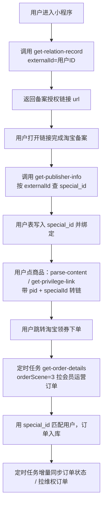

# 大淘客「万能解析转链 + 用户订单归因」接入方案（方案 B）

> 适用场景：小程序对接淘宝客（大淘客开放平台），用户在淘宝下单后，把联盟订单数据准确关联到自己的小程序用户。
> 文档整理自大淘客开放平台官方文档（2026-11-10 抓取），字段与限制以官方最新文档为准。

## 1. 业务场景与问题

- 用户在小程序中看到商品，点击后跳转淘宝领券下单成交。
- 淘宝联盟订单里**没有小程序用户 ID**，无法直接知道"这笔订单是谁下的"。
- 需要一套稳定、可规模化的用户归因机制，并能持续同步订单状态（付款 / 收货 / 结算 / 失效 / 维权）。

## 2. 方案选型结论

| 方案 | 做法 | 结论 |
|---|---|---|
| A. 每用户一个推广位 | 每个用户建一个 adzone（pid 第 3 段） | 不采用：推广位数量有上限，且开放平台无批量建位接口，规模不可控 |
| **B. 一个推广位 + 每用户一个会员/渠道 ID** | 固定 1 个 pid，用户维度用 `specialId`（会员运营 ID）或 `channelId`（渠道关系 ID） | **采用** |

方案 B 的核心：**你的用户 ID（externalId）→ 备案 → special_id → 转链时传 specialId → 订单里带 special_id → 反查用户**。

## 3. 关键概念区分

| 概念 | 字段 | 作用 | 备注 |
|---|---|---|---|
| 推广位 | `pid` / `adzone_id` | 归因的物理载体 | 全平台固定用 1 个即可 |
| 会员运营 ID | `specialId` / `special_id` | 私域用户身份标识 | 需会员备案，订单查询 `orderScene=3` |
| 渠道关系 ID | `channelId` / `relation_id` | 渠道用户身份标识 | 需渠道备案，订单查询 `orderScene=2` |
| 外部用户标记 | `externalId` | 大淘客侧记录的自定义用户标识 | **订单查询不返回**，只能用于备案与转链，不能直接做订单归因 |

> 结论：优先用 **会员运营 ID（specialId）**，把小程序用户 ID 作为 `externalId` 备案，即可自然绑定。

## 4. 整体流程



## 5. 前置准备

1. 大淘客开放平台注册开发者，创建应用，拿到 `appKey` / `appSecret`。
2. 淘宝联盟账号授权到大淘客（获得 `authId`），并创建 1 个固定推广位（`pid`）。
3. 会员备案能力开通（对应 `get-relation-record` / `get-publisher-info` 接口可用）。
4. 回调/跳转域名在小程序后台配置（跳转淘宝需使用官方淘口令 / 短链 / 快站链接方案）。

### 鉴权说明

- 文档公共参数只列 `appKey`、`version`。
- 直连 GET 需要按平台验签规则补充签名参数（`signMethod`、`timestamp`、`nonce`、`sign`），见官方《各语言验签规则及调用示例》。
- 推荐直接使用官方 SDK（Java / PHP / Go），SDK 自动完成验签与参数编码。

## 6. 接口清单

| 用途 | 接口地址 | 方法 | 版本 |
|---|---|---|---|
| 万能解析转链（文案/口令/链接 → 商品 + 转链结果） | `https://openapi.dataoke.com/api/tb-service/parse-content` | GET | v1.0.0 |
| 高效转链（已知商品 ID → 转链） | `https://openapi.dataoke.com/api/tb-service/get-privilege-link` | GET | v1.3.1 |
| 订单查询 | `https://openapi.dataoke.com/api/tb-service/get-order-details` | GET | v1.0.0 |
| 渠道/会员维权订单查询 | `https://openapi.dataoke.com/api/tb-service/get-refund-order-list` | GET | v1.0.0 |
| 获取会员备案授权链接 | `https://openapi.dataoke.com/open-api/tb-service/get-relation-record` | GET | - |
| 查询会员备案信息 | `https://openapi.dataoke.com/open-api/tb-service/get-publisher-info` | GET | - |

## 7. 接口明细

### 7.1 万能解析转链 `parse-content`

**用途**：用户复制的文案中可能含淘口令或链接，解析出商品/活动信息并转链；无商品 ID 时用它。

| 参数 | 类型 | 必填 | 说明 |
|---|---|---|---|
| appKey | String | 是 | 应用唯一标识 |
| version | String | 是 | 固定 `v1.0.0` |
| content | String | 是 | 含淘口令/链接的文本。优先解析淘口令，失败再按序解析链接 |
| pid | String | 否 | 推广位 ID，不传使用应用绑定 pid |
| channelId | String | 否 | 渠道 ID（联盟 relationId），需与 pid 校验通过 |
| authId | Number | 否 | 淘主授权 ID，传了必须配对应授权账号的 pid |
| specialId | String | 否 | 会员运营 ID |
| bybtqdyh | String | 否 | `1` = 转百亿补贴 |
| isSupered | String | 否 | `1` = 品带超红（仅商品）；`3` = 淘金币会场 |

**返回关键字段**（`data` 内）：

| 分类 | 字段 |
|---|---|
| 商品/店铺 | `goodsId`、`title`、`image`、`shopName`、`shopLogo`、`price`、`real_post_fee` |
| 券信息 | `activityId`、`amount`、`startFee`、`startTime`、`endTime`、`status`(0 可用)、`couponSrcScene`(0 全网公开券 / 1 阿里妈妈券)、`couponLink` |
| 解析原始 | `originUrl`、`originType`、`originInfo` |
| 商品/会场通用 | `dataType`(goods/activity)、`itemId`、`itemName`、`mainPic` |
| 转链结果 | `cpsLongUrl`、`cpsFullTpwd`、`shortUrl`、`shortTpwd`、`couponLongUrl` |
| 超红系列 | `couponSuperedLongUrl`、`couponSuperedLongTpwd`、`couponSuperedShortUrl`、`couponSuperedShortTpwd`、`cpsSuperedLongUrl`、`cpsSuperedLongTpwd`、`cpsSuperedShortUrl`、`cpsSuperedShortTpwd` |
| 其他 | `pid`、`bizSceneId` |

### 7.2 高效转链 `get-privilege-link`

**用途**：已拿到 `goodsId`（如从商品列表接口）时，直接转链，字段更全。

| 参数 | 类型 | 必填 | 说明 |
|---|---|---|---|
| goodsId | String | 是 | 淘宝商品 ID |
| couponId | String | 否 | 指定优惠券 ID |
| pid | String | 否 | 推广位 ID |
| channelId | String | 否 | 渠道 ID（relationId） |
| specialId | String | 否 | 会员运营 ID |
| externalId | String | 否 | 淘宝客外部用户标记（如自身系统用户 ID） |
| authId | Number | 否 | 淘宝授权 ID |
| promtionType | Number | 否 | 代理模式必传：1 自购省，2 推广赚 |
| rebateType | Number | 否 | 付定返红包：0 不参与，1 参与 |
| xid | String | 否 | 团长与下游渠道合作标识 |
| leftSymbol / rightSymbol | String | 否 | 淘口令左右符号，默认 `￥` |
| bybtqdyh | String | 否 | `1` = 转百亿补贴 |
| getTopnRate | Number | 否 | 是否获取前 N 件佣金：0 否，1 是 |

**返回关键字段**：
`itemId`、`couponClickUrl`（券推广链接）、`itemUrl`（商品淘客链接）、`shortUrl`、`tpwd`、`longTpwd`（iOS 14 长口令）、`couponInfo`、`couponStartTime`、`couponEndTime`、`couponRemainCount`、`couponTotalCount`、`originalPrice`、`actualPrice`、`maxCommissionRate`、`minCommissionRate`（传 channelId/specialId/externalId 时返回）、`kuaiZhanUrl`（微信可直接访问，仅大淘客商品）。

### 7.3 订单查询 `get-order-details`

| 参数 | 类型 | 必填 | 说明 |
|---|---|---|---|
| queryType | Number | 是 | 1 订单创建时间 / 2 付款时间 / 3 结算时间 / 4 更新时间 |
| startTime | String | 是 | `YYYY-MM-DD HH:MM:SS` |
| endTime | String | 是 | 同上；**日常时间跨度 ≤ 3 小时，大促 ≤ 20 分钟** |
| pageSize | Number | 否 | 默认 20，最大 100 |
| pageNo | Number | 否 | 页码，1~100 |
| positionIndex | String | 否 | 位点，上一页返回的 `position_index`，翻页时回传 |
| jumpType | Number | 否 | `-1` 向前翻页，`1` 向后翻页 |
| orderScene | Number | 否 | 1 常规订单 / **2 渠道订单** / **3 会员运营订单**，默认 1 |
| tkStatus | Number | 否 | 12 付款 / 13 关闭 / 14 确认收货 / 3 结算成功 |
| memberType | Number | 否 | 2 二方，3 三方 |
| authId | Number | 否 | 授权 ID |
| pid | String | 否 | 授权对应的 pid |

**返回结构**：`data.results.publisher_order_dto[]`，并含 `has_pre`、`has_next`、`page_no`、`page_size`。

**归因关键字段**：
`special_id`（会员运营 ID）、`relation_id`（渠道关系 ID）、`adzone_id` / `adzone_name`、`trade_parent_id`（淘宝订单号）、`trade_id`（子订单号）、`item_id`、`item_title`、`item_num`、`pay_price`、`alipay_total_price`、`pub_share_pre_fee`（付款预估收入）、`pub_share_fee`（结算预估收入）、`tk_status`、`tk_create_time`、`tk_paid_time`、`tk_earning_time`、`refund_tag`、`modified_time`。

> 字段名注意：订单接口返回的是**下划线风格**（`special_id`、`relation_id`、`tk_status`），转链接口是**驼峰风格**（`specialId`、`channelId`）。

### 7.4 维权订单查询 `get-refund-order-list`

| 参数 | 类型 | 必填 | 说明 |
|---|---|---|---|
| searchType | Number | 是 | 1 维权发起时间 / 2 订单结算时间 / 3 维权完成时间 / 4 订单创建时间 / 5 订单更新时间 |
| refundType | Number | 是 | 1 二方 / 2 三方 / 0 不限 |
| bizType | Number | 是 | 1 渠道关系 ID / 2 会员关系 ID |
| startTime | String | 是 | 查询开始时间 |
| pageSize / pageNo | Number | 否 | 分页 |

### 7.5 会员备案：`get-relation-record`（获取授权链接）

| 参数 | 类型 | 必填 | 说明 |
|---|---|---|---|
| externalId | String | 是 | 私域用户唯一标识（直接用你的用户 ID） |
| externalType | String | 是 | 0 其他 / 1 微信 / 2 微博 / 3 抖音 / 4 快手 / 5 QQ |
| opType | Number | 是 | 1 新绑 / 2 更新 |
| redirectUrl | String | 是 | 备案完成后跳转的转链商品短链 |
| authId | Number | 否 | 授权 ID，不传用默认授权 |
| ucrowdId | String | 否 | 人群标签 ID |

**返回**：`url`（备案授权链接，引导用户打开完成备案）。

### 7.6 会员备案：`get-publisher-info`（查 special_id）

| 参数 | 类型 | 必填 | 说明 |
|---|---|---|---|
| externalId | String | 是 | 私域用户唯一标识 |
| externalType | String | 是 | 同上报备类型 |
| authId | Number | 否 | 授权 ID |

**返回**：`total_count`、`inviter_list[]`，每项含 `account_name`（会员淘宝昵称）、`create_date`（备案时间）、`special_id`（会员关系 ID）、`root_pid`（推广位 PID）。

## 8. 本地数据结构建议

```sql
-- 用户与归因 ID 绑定
t_user (
  id            bigint primary key,      -- 小程序用户 ID，同时作为 externalId
  openid        varchar(64),
  dtk_pid       varchar(64),             -- 固定推广位
  special_id    varchar(64),             -- 会员运营 ID（备案后回填）
  relation_id   varchar(64),             -- 渠道关系 ID（如用渠道方案）
  bind_status   tinyint,                 -- 0 未备案 1 已备案
  bind_time     datetime
);

-- 联盟订单
t_dtk_order (
  id                 bigint primary key,
  trade_parent_id    varchar(64)  not null,  -- 淘宝父订单号
  trade_id           varchar(64)  not null,  -- 子订单号
  user_id            bigint,                  -- 通过 special_id/relation_id 反查
  special_id         varchar(64),
  relation_id        varchar(64),
  adzone_id          bigint,
  item_id            bigint,
  item_title         varchar(255),
  item_num           int,
  pay_price          decimal(10,2),
  pub_share_pre_fee  decimal(10,2),
  pub_share_fee      decimal(10,2),
  tk_status          int,
  refund_tag         tinyint,
  tk_create_time     datetime,
  tk_paid_time       datetime,
  tk_earning_time    datetime,
  modified_time      datetime,
  raw_json           longtext,
  unique key uk_order (trade_parent_id, trade_id)
);
```

## 9. 实施要点

1. **备案时机**：在用户首次点击商品前触发备案（拿到 `url` 让用户打开淘宝完成授权），或采用"一键授权"引导页；未备案成功就无法用 `specialId` 归因。
2. **转链归属**：所有转链请求统一带 `pid` + `specialId`（会员方案）或 `pid` + `channelId`（渠道方案），不要混用。
3. **订单拉取策略**：
   - 新订单：`queryType=2`（付款时间）+ `orderScene=3`，滚动窗口拉取；
   - 状态更新：`queryType=4`（更新时间）做增量，落到 `t_dtk_order` 做 upsert；
   - 回补历史：`queryType=3`（结算时间）按月回补，校验佣金。
4. **窗口限制**：日常每次查询 ≤ 3 小时，大促 ≤ 20 分钟；建议每 5~10 分钟跑一次，记录上次成功拉取时间，失败自动重试并对齐时间窗口。
5. **翻页**：`data.has_next` 为 true 时继续；优先用 `position_index` + `jumpType=1`，页数超过 100 时位点翻页更可靠。
6. **幂等**：以 `trade_parent_id + trade_id` 唯一键 upsert，重复拉取不会产生脏数据。
7. **对账**：结算金额以 `pub_share_fee` 为准；`refund_tag=1` 或 `tk_status=13` 的要回滚用户收益。
8. **异常兜底**：解析失败（`parse-content` 返回空）时提示用户重新复制文案，文档明确建议"解析失败请再试一次"。
9. **时区/格式**：所有时间参数为 `YYYY-MM-DD HH:MM:SS`，按北京时间处理。

## 10. 待确认事项

- [ ] 渠道方案（`relationId`）的备案入口与限制：当前开放平台未提供渠道备案接口，一般在淘宝联盟/大淘客后台操作，需确认批量能力与上限。
- [ ] 会员备案的开通条件与数量限制（是否按授权账号限制 total_count）。
- [ ] 小程序跳转淘宝的合规链路：直接 `shortUrl` / 淘口令复制 / `kuaiZhanUrl`（微信内）在小程序内的可用性需实测。
- [ ] 大促期间的窗口缩短规则是否随接口返回提示（需在 error 分支处理并自动收敛时间窗）。

## 11. 参考链接

- 万能解析转链：https://www.dataoke.com/kfpt/api-d.html?id=33
- 高效转链：https://www.dataoke.com/kfpt/api-d.html?id=7
- 订单查询：https://www.dataoke.com/kfpt/api-d.html?id=27
- 渠道/会员维权订单查询：https://www.dataoke.com/kfpt/api-d.html?id=87
- 获取会员备案授权链接：https://www.dataoke.com/kfpt/api-d.html?id=135
- 查询会员备案信息：https://www.dataoke.com/kfpt/api-d.html?id=136
- 各语言验签规则：https://www.dataoke.com/kfpt/open-gz.html?cid=31
- 各语言 SDK：https://www.dataoke.com/kfpt/open-gz.html?cid=32
